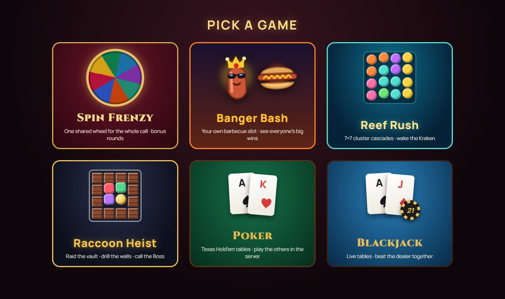
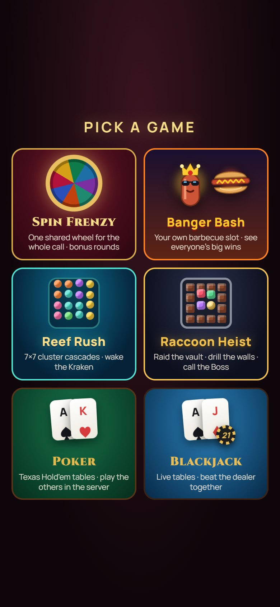
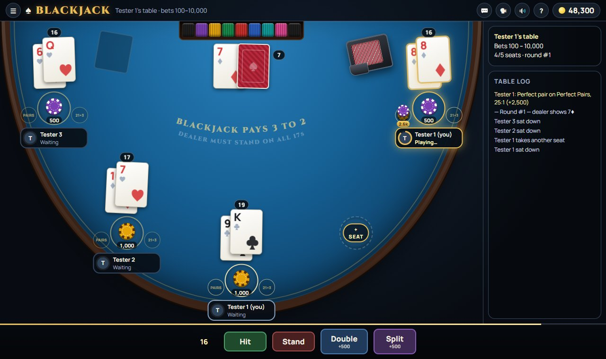
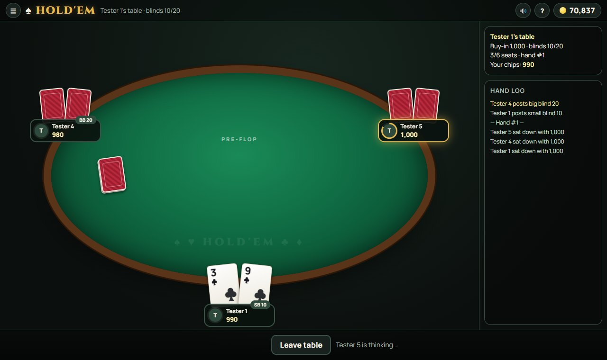
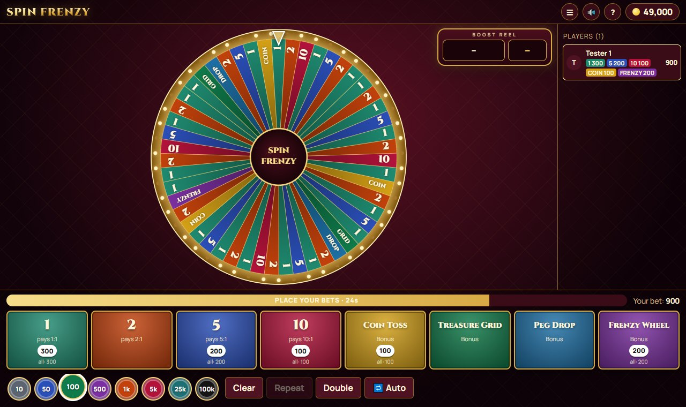
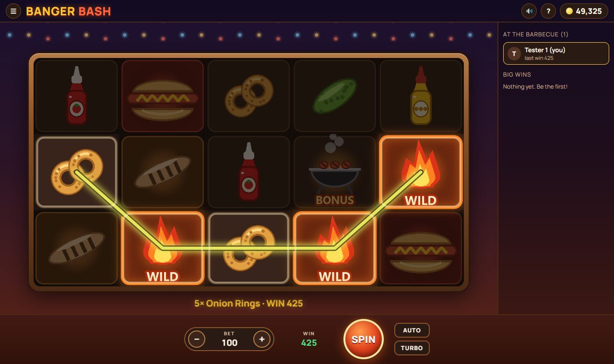
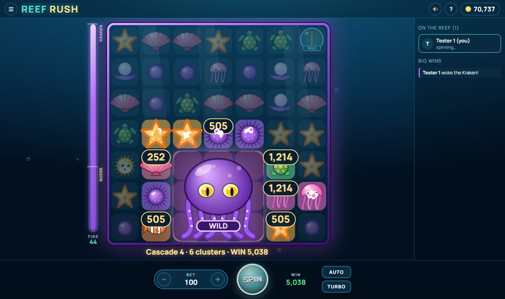
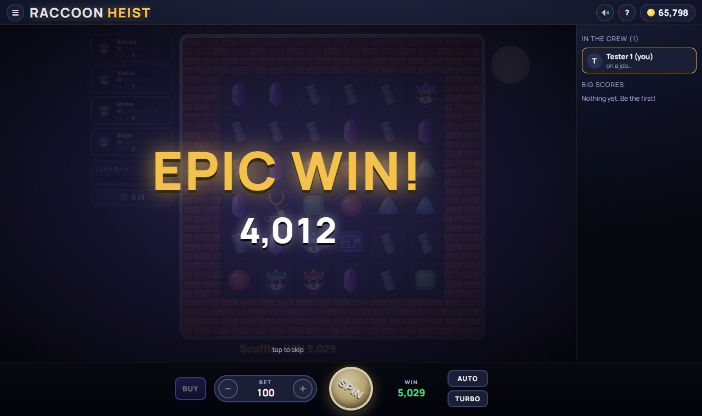

# 🎰 JaxCasino

> **A hobby project, written by Claude.** All of the code and this README were written by Claude (Anthropic's AI);
> SnackaJax decides what gets built and tries it out. It's made for fun on a private Discord server: the credits are
> play money, with no real money involved.

A Discord gambling bot with 16 games (four of them also in a Discord Activity), a shop, a credit economy and admin tools. Built with Python, discord.py and SQLite.

## Screenshots

The casino runs as a Discord Activity: everyone in a call or channel can open it and play together. These were taken
on the local test server (`python -m activity.devserver`), so the players are test accounts.

<p align="center">
  
  
</p>

| | |
|:-:|:-:|
| **Blackjack**: live tables with side bets. Here a Perfect Pairs win (25:1) is stacked on its bet, and one player plays two seats. | **Poker**: Texas Hold'em tables against the others in the server. |
|  |  |
| **Spin Frenzy**: one shared wheel for the whole call, with bonus rounds. | **Banger Bash**: a barbecue slot with wild flames and a bonus game. |
|  |  |
| **Reef Rush**: 7×7 cluster cascades. Here the Kraken woke up. | **Raccoon Heist**: raid the vault, drill the walls, call the Boss. |
|  |  |

## Setup

### 1. Create the Discord bot
1. Go to <https://discord.com/developers/applications> → **New Application**.
2. Open **Bot** → **Reset Token** and copy the token.
3. On the same page, enable **Server Members Intent** (needed for `/admin give-all` and `/admin remove-all`).
4. Open **OAuth2 → URL Generator**, tick the `bot` and `applications.commands` scopes, then these bot permissions:
   *Send Messages, Embed Links, Read Message History, Manage Messages, Use External Emojis*,
   plus these for the shop: *Move Members, Mute Members, Deafen Members, Timeout Members (Moderate Members), Manage Nicknames*.
   Open the generated URL to invite the bot to your server.
5. For timeouts and nickname changes, drag the bot's role above the roles of the members it should be able to affect (Server Settings → Roles). Discord never lets a bot time out administrators or rename the server owner.

### 2. Download and configure
Download the latest release from the [Releases page](../../releases) and unpack it, or clone the repository:
```bash
git clone https://github.com/SnackaJax/JaxCasino.git
```
```bash
cd JaxCasino
```
Copy the example settings (on Windows: `copy .env.example .env`):
```bash
cp .env.example .env
```
Edit `.env`:
- `DISCORD_TOKEN`: the bot token.
- `GUILD_ID`: your server ID (right-click the server → Copy Server ID; turn on Developer Mode in Discord settings first). With this set, slash commands appear instantly.
- `ADMIN_ROLE_IDS` / `ADMIN_USER_IDS`: who can use admin commands. The server owner is always an admin.
- `GAMBLING_CHANNEL_IDS`: the channel(s) where games are allowed. You can also set these from Discord with `/config channel-add`.
- `DISCORD_CLIENT_SECRET`: only needed for the Activity (the casino in voice calls), see [step 4](#4-optional-the-activity-casino).
- `LOG_LEVEL` (optional): how much the console shows: `INFO` (default) or `DEBUG` for everything.
- `LOTTERY_BANK_BONUS` (optional): credits the bank adds to every lottery draw's jackpot, on top of ticket sales (default `0`). It's only paid when the round sold tickets and doesn't carry over; `/lottery info` shows it as part of the jackpot.

Never share or commit `.env`: anyone with the bot token can take over the bot.

### 3a. Run it with Docker (recommended)
You need [Docker](https://docs.docker.com/get-docker/) with Compose. From the bot's folder:
```bash
docker compose up -d --build
```
That builds the image and starts the bot in the background. It restarts by itself after a crash or reboot. Watch it start with:
```bash
docker compose logs -f jaxcasino
```
Optional, the live blackjack dealer's voice (about 350 MB; without it the dealer only talks on devices with their own speech voices, which Android's Discord app doesn't have):
```bash
docker compose run --rm jaxcasino python download_voices.py
```
```bash
docker compose restart jaxcasino
```
What goes where:
- The database (`gamble.db`) and the log files are kept in the `jaxcasino-data` volume, and the voice models in `jaxcasino-voices`, so they survive rebuilds and updates.
- `docker-compose.yml` sets `DATABASE_PATH`, `LOG_DIR`, `ACTIVITY_HOST` and `ADMIN_PANEL_HOST` itself, so leave those as they are in `.env`.
- The Activity's web server is published on `127.0.0.1:8765`: reachable from this machine only, for your tunnel or reverse proxy.
- The admin panel (when it's on) is published on `127.0.0.1:8780`, for your own browser only (or on your LAN as well with `ADMIN_PANEL_BIND=0.0.0.0`).

**Updating:** download the new release (or `git pull`), then `docker compose up -d --build`. Your database is kept.

**Backups:** copy the database out of the volume while the bot runs (SQLite in WAL mode, so stop the bot first for a fully consistent copy):
```bash
docker compose cp jaxcasino:/data/gamble.db ./gamble-backup.db
```

### 3b. Or run it with Python
You need Python 3.13 (the version the Docker image uses).
```bash
pip install -r requirements.txt
```
```bash
python download_voices.py
```
(optional: the blackjack dealer's voice, about 350 MB)
```bash
python bot.py
```
The database (`gamble.db`) and `logs/` are created in the bot's folder.

### 4. (Optional) The Activity: casino
The Activity is the casino that opens inside Discord voice calls (the screenshots above). It needs a public HTTPS address for the bot's web server; the full steps are under [Spin Frenzy → Setup](#spin-frenzy). In short:
1. Developer Portal → your application → **OAuth2**: put the **Client Secret** in `.env` as `DISCORD_CLIENT_SECRET`, and add any redirect URL (for example `https://127.0.0.1`).
2. Give the web server (port 8765) a public HTTPS address. With Docker the easiest way is the built-in Cloudflare quick tunnel: `docker compose --profile tunnel up -d`, then find the address with `docker compose logs tunnel`. That address changes every time the tunnel restarts; use a named [Cloudflare Tunnel](https://developers.cloudflare.com/cloudflare-one/connections/connect-networks/) or your own reverse proxy for a permanent one.
3. Developer Portal → **Activities → URL Mappings**: set `/` to that address (without `https://`), and turn on **Activities → Settings → Enable Activities**.
4. Restart the bot and use `/casino` in a server.

If you don't want the Activity at all, set `ACTIVITY_ENABLED=0` in `.env`.

### 5. (Optional) The admin panel
A website for you, the bot's owner, served by the bot on your own machine: stats and graphs, a pie chart of who holds the credits, every player's balance in a filterable list, and balance editing (set an exact amount, add or remove, with an optional note). Edits made there are never announced in Discord; they're logged in the panel and count as admin changes in `/serverstats`.
1. In `.env`, set `ADMIN_PANEL_ENABLED=1` and pick a password for `ADMIN_PANEL_PASSWORD`.
2. Docker: `docker compose up -d --build` (the image builds the page). Python: the page has to be built once with [Node.js](https://nodejs.org) 20 or newer: `cd admin_panel/web`, `npm ci`, `npm run build` (again after every update).
3. Restart the bot and open <http://127.0.0.1:8780>.

It only listens on this machine (`127.0.0.1`; in Docker the port is published on `127.0.0.1` only). To use it from your phone or another computer at home, run it in Docker with `ADMIN_PANEL_BIND=0.0.0.0` in `.env` and run `docker compose up -d`; it's then at `http://<this machine's LAN address>:8780`. Everyone on that network can reach the sign-in page, so pick a strong password and only do this on a network you trust. Don't point a tunnel or reverse proxy at it. Change the password in `.env` and restart to sign everyone out.

**Sign in with Discord:** when `DISCORD_CLIENT_SECRET` is set (the Activity needs it too), the sign-in page also has a "Sign in with Discord" button. It lets in the bot's owner in the Developer Portal (or every member of its team), plus anyone whose Discord user ID is in `ADMIN_PANEL_USERS` (separated by commas). The password keeps working next to it. In the Developer Portal, add each address you open the panel on under OAuth2 → Redirects, ending in `/api/auth/discord`: for example `http://127.0.0.1:8780/api/auth/discord`, and `http://<LAN address>:8780/api/auth/discord` if you use it from your network.


**Working on the panel:** `python -m admin_panel.devserver --seed --live` runs it without Discord at <http://127.0.0.1:8781> (password `dev`) on a test database (`admin_dev.db`) with made-up players, and keeps playing made-up games for the Live view. For hot reload while editing the page, also run `npm run dev` in `admin_panel/web` and open <http://localhost:5180>. The page is React with [shadcn/ui](https://ui.shadcn.com) and the [OpenStatus data-table-filters](https://data-table.openstatus.dev) blocks (MIT), dark mode only.

## Commands

### Economy
| Command | Description |
|---|---|
| `/balance [user]` | Show a balance |
| `/claim` | Claim 400 credits, once every 24h (missed days don't stack) |
| `/restart` | Broke? Press a button to get 500 credits (see below) |
| `/pay <user> <amount>` | Send credits to someone |
| `/leaderboard` | The richest players |
| `/stats [user] [period]` | A player's balance over time as a graph: change and % change, peak and low, biggest drop, where the change came from (games, claims, restarts, shop…) and profit per game. Opens on the last 24 hours; buttons switch between 24 hours, 7 days, 30 days and all time |
| `/serverstats [period]` | Server-wide stats page: total wagered and paid out, house profit, wagers per game, daily volume, busiest hours, biggest wins and losses, and the economy. Opens on the last 24 hours; buttons switch between 24 hours, 7 days, 30 days and all time |
| `/help` | List all games |

### Shop
`/shop` shows the items and this server's prices (only you see it). Buy with `/buy`:
| Command | Default price | What it does |
|---|---|---|
| `/buy chicken` | 1,000 | A fighting chicken for `/cockfight` (one at a time) |
| `/buy disconnect <user>` | 5,000 | Disconnects someone from voice |
| `/buy mute <user> <duration>` | 1 min: 1,000 · 5 min: 4,000 | Server-mutes someone in voice (they can't talk). Buying again adds time |
| `/buy deafen <user> <duration>` | same as mute | Server-deafens someone in voice (they can't hear). Buying again adds time |
| `/buy timeout <user> <duration>` | 5 min: 8,000 · 15 min: 20,000 · 30 min: 35,000 | Times someone out. Buying again adds time |
| `/buy nickname <user> <name>` | 10,000 | Changes someone's nickname |
| `/buy random-kick` | 2,500 | Disconnects a random person in voice (anyone, even the buyer) at a random moment within 5 minutes |

Disconnects, mutes, deafens, timeouts and nickname changes are announced in the channel. **Random kicks are secret:** the purchase reply is visible only to the buyer, nothing is posted in the channel, and the Discord audit log entry gives no buyer, only the reason "Random kick". The buyer is told privately who got hit. If nobody is in voice when it fires, the buyer gets their credits back. If an action fails (missing permission, the target outranks the bot), nothing is charged. Mutes, deafens and random kicks survive a bot restart; a mute or deafen that runs out while its target is out of voice is lifted when they rejoin.

Bets and payments accept any whole amount (`1234`, `1,234,567`), plus optional shortcuts: `2.5k`, `1m`, `half`, `all`.

### Games (gambling channels only)
| Command | Game |
|---|---|
| `/coinflip` | Heads or tails, pays 1.96x |
| `/dice` | Roll 1–100 over/under a target; the payout scales with the odds |
| `/roulette` | European roulette: colors, odd/even, high/low, dozens, columns, single numbers |
| `/wheel` | Wheel of fortune, 0x–5x |
| `/cockfight` | Bet on your chicken (`/buy chicken`). Pays 1.96x. It starts at a 50% win chance, gains 1% per win (max 70%), and dies when it loses. `/chicken [user]` shows a chicken's record |
| `/blackjack` | Hit, stand, double, split; 3:2 blackjack; dealer stands on 17 |
| `/higherlower` | Guess the next card, cash out any time |
| `/mines` | 4×5 grid with 1–19 mines, cash out any time |
| `/crash` | Live multiplier, cash out before it crashes (optional auto cash-out) |
| `/tower` | Climb 8 floors in 4 difficulties, cash out any time |
| `/videopoker` | Jacks or Better (9/6 paytable) |
| `/slots` | **Cosmic Lab**: 6 reels × 4 rows, 20 paylines, wilds, and free spins with sticky wilds. **Spin again** repeats your bet; `/paytable` (or the button) shows the pays and all 20 lines |
| `/duel` | Challenge a player: coinflip, dice or rock-paper-scissors |
| `/horserace` | Open a race; everyone bets on horses with fixed odds |
| `/lottery buy / info` | Shared jackpot, drawn every 24h. The bank can add a bonus to every draw (`LOTTERY_BANK_BONUS` in `.env`) |
| `/poker create` | Multiplayer Texas Hold'em table (Join / Leave / Start buttons) |
| `/casino [game]` | Opens the bot's Discord Activity (the casino) in a voice call or text channel: a game menu with **Spin Frenzy** (a live wheel game show), **Banger Bash** (a 5×3 barbecue slot), **Poker** (Texas Hold'em tables), **Blackjack** (live tables against the dealer) and, once switched on, **Reef Rush** (a 7×7 cluster slot) and **Raccoon Heist** (an 8×8 vault-raid slot). Pick a `game` to go straight to it. See below |
| `/bangerbash-paytable` | Banger Bash's pays, features and bonus rules. A chat version of Banger Bash also exists but is switched off; set `BANGERBASH_IN_CHAT=1` in `.env` to add `/bangerbash <bet>`, which plays it in the text channel |

### The Activity (the casino): Spin Frenzy, Banger Bash, Poker, Blackjack, Reef Rush and Raccoon Heist
`/casino` opens the bot's Discord Activity on a game menu, or straight into one game with its `game` option. Players pick a game, and the ☰ button in each game goes back to the menu.

#### Poker
The same no-limit Texas Hold'em as `/poker` in chat (side pots, split pots, the `POKER_RAKE` setting), at an animated table: the cards fly from the deck to every seat and turn over, bets slide out as chips and sweep into the pot at the end of each round, the flop, turn and river slide out and flip one by one, the showdown turns everyone's cards over and lights up the winning five, and the pot slides to the winner. A ring around the player to act runs down their 30 seconds. Every server has one poker room: anyone in it (from any call or channel) sees its tables, can watch one, open a new one (buy-in and 2–8 seats; the blinds are a fiftieth and a hundredth of the buy-in) or sit down. The host deals the first hand once two players sit; after that a new hand starts by itself. Buy-ins are held in escrow as `poker`, like the chat tables: leaving the table pays the chips back, and if the bot restarts mid-hand everyone gets back the chips they had when that hand started. A player who closes the Activity keeps their seat; if they don't act in time they check or fold, and two timeouts in a row take them off the table (cashed out).

#### Blackjack
Live blackjack: several players at one table, each playing their own hands against the dealer. The rules are the same as `/blackjack` in chat (`cogs/blackjack.py`: 6-deck shoe, dealer stands on all 17s, blackjack pays 3:2, double on any two cards, split up to 4 hands with split aces getting one card each, and the same dealer face-up card rule), and the chat game stays as it is. Every server has one blackjack room: anyone in it sees its tables, can watch one, open a new one (a minimum bet and 1–7 seats; the maximum bet is 100× the minimum, capped at `MAX_BET`) or click an empty seat to sit down. A player can take as many of the free seats as they like (**+ SEAT** on an empty one; `MAX_SEATS_EACH` in `activity/blackjack.py` can set a limit), each with its own bets and hands. With two or more seats, the **⧉ All seats** switch (next to Main / Pairs / 21+3) copies every chip onto all your seats at once, side bets included; a seat that can't take it (at the table maximum, or no main bet yet for a side bet) is skipped. It's on by default; switched off, tapping one of your seats puts your chips there, and the page remembers the choice. **Clear**, **Rebet**, **×2** and **Deal** work on all your seats either way, and × on a seat leaves just that one. There's no buy-in: each round, the players bet straight from their balance by tapping chips onto their betting circle (**Rebet** and **×2** included). Betting closes 15 seconds after the first bet, or as soon as everyone seated has pressed **Deal**. Players act in turn from the dealer's left, with 20 seconds per decision (Hit, Stand, Double, Split; keys H, S, D, P). Then the dealer turns over the hole card and draws. Everything is animated: chips slide onto the circles, cards fly out of the shoe and turn over, split hands slide apart, a doubled card lies sideways, busted bets go to the dealer's rack, winnings come out of it with a coin shower for your own wins, and the cards are swept into the discard tray. The shoe is reshuffled once it's three-quarters used.

**Side bets:** each seat has two small circles next to its betting circle. Players pick **Pairs** or **21+3** above the chips (or tap the circle) to put chips on them. A side bet needs a main bet and can be at most as big as it, and it's paid straight after the deal, whatever happens to the hand: the winnings come out of the rack and are stacked on top of the side bet, and stay there until the round is paid. **Perfect Pairs** (the player's first two cards): perfect pair 25:1, coloured pair 12:1, mixed pair 6:1. **21+3** (the first two cards plus the dealer's face-up card as a poker hand): suited trips 100:1, straight flush 40:1, three of a kind 30:1, straight 10:1, flush 5:1. With 6 decks and the dealer face-up card rule, they return about 94% and 95.5% (simulated over 1.5 million deals). Side bets are held in the same escrow as the main bet, and the round's result in `/stats` includes them.

**The dealer's voice:** the dealer speaks: "Place your bets, please" when betting opens, "No more bets, thank you" when it closes, side bet wins, "Blackjack for …!", "Dealer busts!", and at the end of each round the dealer's total, a congratulation and what each winner won that round (side bets included). The voice is made on the bot's own machine with [Kokoro](https://github.com/thewh1teagle/kokoro-onnx), an offline neural text-to-speech, so nothing is sent to an outside service and everyone hears the same dealer, including on Android, whose Discord app has no speech synthesis of its own. The page asks `POST /api/voice` for each line a sentence at a time (signed-in players only, at most 240 characters, 60 sentences a minute per player) and plays the WAVs it gets back; the lines are worded the same for everyone at the table (names, never "you"), so each one is made once and shared, the ones every round needs are made at startup, and recent lines are cached. Setup: `pip install -r requirements.txt` (it includes `kokoro-onnx`), then put `kokoro-v1.0.onnx` and `voices-v1.0.bin` from the [kokoro-onnx model release](https://github.com/thewh1teagle/kokoro-onnx/releases/tag/model-files-v1.0) in `voices/` (about 350 MB). `DEALER_VOICE_NAME` in `.env` picks the speaker (default `af_heart`; `af_bella`, and the British `bf_emma`, are nice too). `DEALER_VOICE_MODEL` can instead point at a [Piper](https://github.com/OHF-Voice/piper1-gpl) voice model, like `voices/en_US-lessac-medium.onnx` (`python -m piper.download_voices en_US-lessac-medium --download-dir voices`): much faster, but more robotic. Without the package or the model, the bot logs `Dealer voice is off` at startup and the page uses the device's own speech voices where it has them (desktop and iOS, not Android). The 🗣 button turns the voice off, and muting the sound silences it too. Bets are escrowed as `blackjack` (so `/stats` and `/serverstats` count both versions together) and refunded if the bot restarts mid-round. A player who runs out of time stands; two timeouts in a row, or 5 rounds without a bet, take them off the table, and a player who closed the Activity loses an empty seat after a minute.

#### Banger Bash
Every player plays their own slot machine at their own pace. Everyone in the server with Banger Bash open shares one lobby, whether they started the Activity in a voice call or in a text channel. A side panel shows who else is at the barbecue and what they're doing (spinning, in the Grill Bonus, their last win), and bonus triggers and big wins (10x and up) are announced to everyone. A player's result is only shown to the others once their own screen has finished animating it. The reels spin and stop with a bounce, the last reels hold and glow when two grills have landed, wins count up with ticking sounds, and BIG / MEGA / EPIC WIN screens come with a coin shower and a fanfare. Every sound is generated in the browser, so there are no audio files. **Auto** keeps spinning until it's stopped or a bonus starts, **Turbo** halves the animations, and the space bar spins.

`/casino game:Banger Bash` goes straight to it. The game is the same as the chat version (`utils/banger_engine.py`); the server decides every result and the page only animates it. A round left waiting for a choice (the player closed the Activity mid-bonus) carries on where it was when they come back, and finishes itself with default choices after 10 minutes. Bets are escrowed like every other game and show up in `/stats` and `/serverstats` as `bangerbash`.

#### Reef Rush
**Off until `REEF_RUSH_ENABLED=1` is set in `.env` and the bot is restarted.** While it's off, its card isn't on the game menu, it isn't a `/casino` choice, and its page and connection refuse to open.

A 7×7 cluster-pays slot under the sea. Every player plays their own board, and everyone in the server with Reef Rush open shares one lobby, like Banger Bash: a side panel shows who else is on the reef, and big wins (10x and up) and the Kraken are announced to everyone, but only once the player's own screen has shown them. Symbols drop in column by column, winning clusters light up with their pay and pop, the symbols above fall and new ones drop in, and the Tide Meter beside the board fills with every popped symbol. The board, the meter and the controls resize to fit any screen: the meter sits beside the board on wide screens and above it on tall ones, and on phones held sideways the controls move to a column on the right. Every symbol is drawn by the page with canvas paths, so there are no image files and they stay sharp at any size, and every sound is generated in the browser. Tap the board (or press SPIN) to speed a spin up; **Turbo** speeds every spin up and **Auto** keeps spinning until it's stopped.

`/casino game:Reef Rush` goes straight to it. The game is `utils/reef_engine.py`. A spin has no choices, so the server plays it out completely and settles it the moment it's paid for; the page then animates its steps. Bets are escrowed like every other game and show up in `/stats` and `/serverstats` as `reefrush`.

#### Raccoon Heist
**Off until `RACCOON_HEIST_ENABLED=1` is set in `.env` and the bot is restarted**, like Reef Rush.

Four masked raccoons (Rocco, Violet, Moss and Skye, one per colour) raid an 8×8 bank vault. Every player plays their own vault, and everyone in the server with Raccoon Heist open shares one lobby: a side panel shows the rest of the crew, and big wins (10x and up), Night Shifts and the Boss are announced to everyone once the player's own screen has shown them. The raccoons hop from grab to grab, bricks crumble when a Drill opens the vault, the Boss stomps in and dashes across the board, and Vault Grab opens its lockers one by one. Every symbol, raccoon and the Boss is drawn by the page with canvas paths and every sound is generated in the browser, so there are no image or audio files. Tap the vault (or press SPIN) to speed a round up; **Turbo** speeds every round up and **Auto** keeps spinning until it's stopped. **BUY** opens the bonus buys (`HEIST_BUYS=0` hides them).

`/casino game:Raccoon Heist` goes straight to it. The game is `utils/heist_engine.py`. A round has no choices (bonuses and Vault Grab play themselves), so the server plays it out completely and settles it the moment it's paid for; the page then animates its steps. Bets and buys are escrowed like every other game and show up in `/stats` and `/serverstats` as `raccoonheist`.

#### Spin Frenzy
Everyone in a voice call who opens the Activity shares one wheel. Each round: bet with your server credits while the timer runs (15s), the **Boost Reel** picks a spot and a multiplier (2x–50x), the wheel spins, and if a bonus segment wins, everyone who bet on it plays that bonus:
- **Number spots 1, 2, 5, 10** pay 1:1, 2:1, 5:1 and 10:1.
- **Coin Toss**: gold and silver each get a multiplier, then the coin is flipped.
- **Treasure Grid**: 48 multipliers are shown, hidden and shuffled; each player picks a chest. Every game has 1 or 2 big chests worth 75x–200x (gold).
- **Peg Drop**: a ball bounces down to a multiplier slot; DOUBLE slots double the board and drop again. Every board has 1 or 2 big slots worth 75x–500x on its outer edges, which the ball reaches 1.5% of the time each (like a real plinko board).
- **Frenzy Wheel**: each player picks one of three pointers; DOUBLE/TRIPLE multiply that pointer's result and respin.

Bets are held in escrow like every other game (refunded if the bot restarts mid-round) and show up in `/stats` and `/serverstats` as `spinfrenzy`. The number spots return `SPIN_FRENZY_RTP` (97% by default). Bonus rounds come up more often than their share of the wheel (`SPIN_FRENZY_BONUS_WEIGHT`, 1.5 = a bonus about every 4.6 spins) and return `SPIN_FRENZY_BONUS_PAYBACK` (100% by default, break-even on average). To hit that, each bonus prize table reshapes its everyday prizes; the big prizes keep a fixed chance (the 75x–500x coin values, the 1–2 big chests in every Treasure Grid, the 1–2 big edge slots on every Peg Drop board, and the 100x–1000x Frenzy Wheel segments). Keep the bonus payback at or below 1.00: above it, players who only bet on bonuses get richer every evening. Every round is written to the log (`Spin Frenzy round ...`: winning spot, bonus value, boost, total staked and paid). The page's **?** button shows each spot's real chance of winning. `python -m activity.engine 0.97 1.5 400000 1.0` prints the exact odds and prize tables and checks them with a simulation.

**Setup** (one time):
1. In the [Developer Portal](https://discord.com/developers/applications), open the bot's application → **OAuth2**: copy the **Client Secret** into `.env` as `DISCORD_CLIENT_SECRET`, and add any redirect URL (for example `https://127.0.0.1`); Discord requires one even though Activities don't use it.
2. The bot runs the Activity's web server on `ACTIVITY_HOST:ACTIVITY_PORT` (default `127.0.0.1:8765`). Discord needs it over public HTTPS. The easiest way is a [Cloudflare Tunnel](https://developers.cloudflare.com/cloudflare-one/connections/connect-networks/) on the same machine: `cloudflared tunnel --url http://localhost:8765` for a quick test (the URL changes each time), or a named tunnel for a permanent address. In Docker, `docker compose --profile tunnel up -d` starts that quick tunnel next to the bot (see [step 4](#4-optional-the-activity-casino)).
3. Portal → **Activities → URL Mappings**: set the root mapping `/` to your tunnel's host (without `https://`).
4. Portal → **Activities → Settings**: turn on **Enable Activities**. Discord then adds a "Launch" command to the app. The bot's command sync keeps it.
5. Restart the bot. In a voice channel, press the 🚀 Activities button and pick the bot, or use `/casino`.

**Testing without Discord:** `python -m activity.devserver` serves the game menu at <http://localhost:8766/?user=1&name=Alice>, using its own `activity_dev.db` with fake logins. Open a second tab with `?user=2` to play as another player. `--force coin,grid,drop,frenzy` makes the Spin Frenzy wheel land on those spots in turn, and `--banger flame,mystery,mega,hot,respin,charcoal,sure,bonus,bonus5,potato,picnic,grillspins,twinlinks,golden` gives Banger Bash spins those features or bonuses in turn. The dev server always has Reef Rush and Raccoon Heist switched on; `--reef win,big,surge,whirlpool,riptide,undertow,shift,kraken,bubble` gives Reef Rush spins those outcomes in turn, and `--heist win,big,raid3,scuffle,teamup,wall,paint,hook,boss,grab,bonus` does the same for Raccoon Heist's paid spins. `--blackjack 8,6,8,K` stacks the live blackjack shoe: those ranks are dealt first, in dealing order (the players' first cards, the dealer's face-up card, the players' second cards, the hole card, then every hit).

### Admin
| Command | Description |
|---|---|
| `/admin give <user> <amount>` | Give credits |
| `/admin remove <user> <amount>` | Remove credits (won't go below 0) |
| `/admin set <user> <amount>` | Set an exact balance |
| `/admin give-all <amount>` | Give credits to every member (asks for confirmation) |
| `/admin remove-all <amount>` | Remove credits from every member (asks for confirmation) |
| `/lottery draw` | Draw the lottery now |
| `/poker close` | Close the table in this channel (the table host can also do this) |
| `/config channel-add / channel-remove` | Manage the gambling channels |
| `/config adminrole-add / adminrole-remove` | Manage admin roles |
| `/config adminuser-add / adminuser-remove` | Manage admin users |
| `/config shop-price <item> <price>` | Change a shop price on this server (0 = not for sale) |
| `/config show` | Show the current settings |

## How it works
- **House edge:** 2% by default (`HOUSE_EDGE`) on coinflip, dice, mines, tower, crash, higher-or-lower and horse racing. Slots have their own setting, `SLOTS_RTP` (99% by default). The wheel returns 98.5%, and roulette has the standard 2.7% from the single zero. Video poker follows real-casino odds. In blackjack the dealer's face-up card is a 10-value card only 10% of the time instead of the normal 31% (`DEALER_TEN_CHANCE` in `cogs/blackjack.py`), which gives a basic-strategy player about a 4.7% edge over the house.
- **Slots (Cosmic Lab):** your bet covers all 20 lines. Lines pay left to right from the first reel for 3–6 matching symbols, and wins on different lines add up. Wilds land on reels 2–6 and stand in for everything except comets. Each spin lands 3 comets 1 in 149, 4 comets 1 in 900, and 5 or 6 comets 1 in 15,000 (set in `COMET_ODDS` in `utils/slot_engine.py`); 3, 4, 5 or 6 comets give 8, 10, 12 or 15 free spins at the same bet. During free spins every wild that lands sticks until they end (new ones are shown with a glowing NEW tag before the wins), and 3 more comets add 5 spins (50 at most). Alien, UFO and robot cells have red, yellow and green backgrounds. Wins are capped at 2,500x the bet. Over a 10-million-spin simulation: something wins on 42% of spins, more than the bet comes back on 21%, and free spins start about once every 127 spins and average about 46x the bet. Pays are scaled so the game returns `SLOTS_RTP` from `.env` (99% by default), separate from `HOUSE_EDGE`. The game logic is in `utils/slot_engine.py` and the picture in `utils/slot_image.py`.
- **Banger Bash:** your bet covers all 20 lines; lines pay left to right from the first reel for 3–5 matching symbols. 🔥 Flame Wilds land on reels 2–5 and stand in for everything except the grill. About one spin in 11 gets a random feature: **Flame Wilds** (2–5 cells turn wild), **Mystery Buns** (buns that all reveal the same symbol), **Mega Banger** (a 3×3 symbol across reels 2–4), **Hot Reels** (whole reels turn wild), **Extra Charcoal** (at least 2 grills) or **Sure Sizzle** (a guaranteed win); a losing spin sometimes gets a **Second Helping** (one reel spins again). 3 or more grills start the **Grill Bonus**: a light runs up the feature ladder and lands on one of **Hot Potato** (pick sausages, dodge the burnt one), **Picnic Pick** (open hampers until the ants show up), **Grill Spins** (11 free spins, multiplier +1 after every win), **Twin Links** (8 free spins with two linked 2x wilds every spin) and **Golden Grill** (a multiplier that climbs until the grill cools, up to 500x); 4 or 5 grills skip the lowest rungs. Before playing, the player can **turn up the heat** up to 5 times: win and the feature climbs a rung, lose and it drops one (from Hot Potato the bonus burns). Each gamble's odds come from the features' average values, so gambling neither gains nor loses on average. Wins are capped at 5,000x the bet. Over a 6-million-spin simulation: something wins on 40% of spins, more than the bet comes back on 15%, and the Grill Bonus starts about once every 79 spins. Pays are scaled so the game returns `BANGER_RTP` from `.env` (99% by default). `python -m utils.banger_engine` re-runs the simulation, and `python -m utils.banger_engine features` measures each bonus feature (re-measure after changing a feature: the gamble odds use those numbers). The chat pictures are drawn in `utils/banger_image.py`; the Activity uses the same drawings as sprites in `activity/static/banger/`, regenerated with `python -m activity.assets.make_banger_sprites`.
- **Reef Rush:** a 7×7 grid. 5 or more matching symbols touching up, down, left or right make a cluster, wilds join any cluster, and every cluster pays by its size (5 to 15+) times the bet. Then its symbols vanish, the ones above fall and new ones drop in, and that repeats while new clusters form. There are 4 low symbols (Scallop, Pearl, Urchin, Starfish) and 4 high ones (Clownfish, Pufferfish, Jellyfish and the Sea Turtle, the top symbol). A cluster of 9 or more leaves a **Pearl Wild** behind. Every popped symbol charges the **Tide Meter**, which starts empty on every spin: when the cascade stops with 10 charges, a random **Surge** hits (**Whirlpool**: 3–6 symbols turn wild; **Riptide**: a wild lands and washes out its row and column; **Undertow**: every low symbol is swept away; **Coral Shift**: one kind of symbol turns into another kind on the board) and the cascade carries on. If it stops again with 32 charges, **the Kraken** lands: a 3×3 wild on the bottom rows that shrinks to 2×2 after a win and splits into 4 wilds after the next one. When the first drop wins nothing, a **Bubble Burst** sometimes pops every symbol of one low kind. Wins are capped at 5,000x the bet. Over a 24-million-spin simulation: something wins on 33% of spins, more than the bet comes back on 17%, a Surge comes about once every 12 spins, the Kraken about once every 340, and a 100x+ win about once every 500. Pays are scaled so the game returns `REEF_RTP` from `.env` (99% by default). `python -m utils.reef_engine 24000000` re-runs the simulation on every core (about 15 minutes); after changing anything in the engine, put its raw payback in `MEASURED_RTP`.
- **Raccoon Heist:** an 8×8 vault; only the middle 6×6 is open at first and the outer ring is brick wall. Every drop, four raccoons (one per colour: Ruby, Amethyst, Emerald, Sapphire) land on random cells and raid in turn: a raccoon raids when 3 or more pieces of its own loot (Golden Masks count) link to it up, down, left or right, grabs everything linked, and ends where its last grab was. Each piece of loot pays its colour's level (1–7) times the bet. Then everything falls, new symbols drop in, and the crew goes again until nobody can raid. Tools: **Stethoscope** (that colour +1 level), **Golden Stethoscope** (every colour +1), **Drill** (knocks a wall side through, the vault grows to 8×8), **Paint Bomb** (the loot and trash around it turn the raccoon's colour), **Cash Bag** (0.5x–1,000x), **Grappling Hook** (the raccoon swings to the nearest loot of its colour and keeps going), **Walkie-Talkie** (calls **the Boss**: when nobody can raid he dashes 4 times across a row or column, every piece of loot pays the best level of any colour, and he leaves a Golden Mask where he lands), **Safe** (**Vault Grab**: 20 lockers, 5 of them alarms, opened until the alarms catch all four raccoons) and **Blueprint** (3 in one spin start the **Night Shift**: 7 free drops, one more for each extra Blueprint, where the vault, the levels and the Loot Meter carry over, and every Blueprint is another drop). Raccoons next to each other may **scuffle** and knock everything around them loose, and every 15 pieces of loot a raccoon grabs fill the Loot Meter for a **Team Up** (every colour +1). Bonus buys (`HEIST_BUYS`, on by default): Blueprint Boost 3.7x the bet (one spin with Blueprints 2.5x as likely), Call the Boss 9x, Vault Grab 57x, Night Shift 82x and Big Score 250x (a Night Shift in a fully open vault with every colour starting at level 3). Wins are capped at 10,000x the bet. Over a 16-million-spin simulation: something wins on 34% of spins, the Night Shift starts about once every 268 spins, and a 100x+ win comes about once every 1,130. Every mode's pays are scaled so it returns `HEIST_RTP` from `.env` (99% by default) of what it costs. `python -m utils.heist_engine 16000000` re-measures every mode (about 30 minutes on 12 cores; put the results in `MEASURED`), and `python -m utils.heist_engine verify 16000000` plays whole rounds through the bot's payout code and prints what each mode really pays back.
- **Interrupted games are refunded:** each bet is held in escrow until its game finishes. If the bot restarts mid-game, every unfinished bet is returned on the next startup. Poker players get back their chip stack as it was at the start of the interrupted hand.
- **Timeouts:** idle button games auto-cash-out (or refund if no move was made), and blackjack auto-stands. In poker, a player who doesn't act within 45s is auto-checked or folded, and two timeouts in a row remove them from the table.
- **Poker:** the table is drawn as an image that updates after every action. It shows the seats, chip stacks, bets, the dealer button, who is to act, and everyone's cards at showdown. The **My cards** button shows your hand as an image only you can see. One table per channel. To run several tables at once, create them in different channels or in threads inside the gambling channel. Side pots, split pots and all-in run-outs are handled automatically.
- **Restart when broke:** when a game leaves a player below the minimum bet, a restart panel tagging them is posted. One press of the button gives them 500 credits, with a confirmation. Broke players who try to bet, or use `/restart`, get the same panel privately. Restarts aren't available while credits are still in an unfinished game, or for a while after sending credits with `/pay` (so nobody can farm them by giving credits away): 3600 seconds (1 hour) by default, set with `RESTART_PAY_BLOCK_SECONDS` in `.env` (`0` turns the lock off). Change the amount with `RESTART_AMOUNT` in `.env`; set `RESTART_PRESSES` above 1 to make players press several times (the panel then counts down).
- **Finding your game:** every game message tags the player who started it (both players in a duel), so Discord highlights your own games in a busy channel.
- **Logs:** the console shows every command, bet result and error. `logs/jaxcasino.log` keeps more detail, including every button press, and rotates at 5 MB (5 old files kept). If a game misbehaves, that file shows what was clicked and what went wrong. If a button handler crashes, the player is told something went wrong and the full error is logged.
- **Randomness:** every game uses the operating system's cryptographically secure random generator.
- **Data:** everything is stored in `gamble.db` (SQLite). Balances are per server. Every finished game and every claim, payment and admin change is also logged with a timestamp for `/serverstats`. Every balance change is also recorded (by a database trigger) for the `/stats` graph. When that recording was first switched on, earlier balances were rebuilt from the game and money logs; that part is approximate, because payments received from others weren't logged per player back then.

## License
JaxCasino is released under the [MIT License](LICENSE). Bundled third-party files keep their own licenses: the
Discord Embedded App SDK in `activity/static/vendor/discord-sdk/` (MIT, see its `LICENSE.md`) and the Cinzel and
Manrope fonts in `activity/static/fonts/` (SIL Open Font License, see the `OFL-*.txt` files). The dealer's voice
models are downloaded separately and come with their own licenses.
